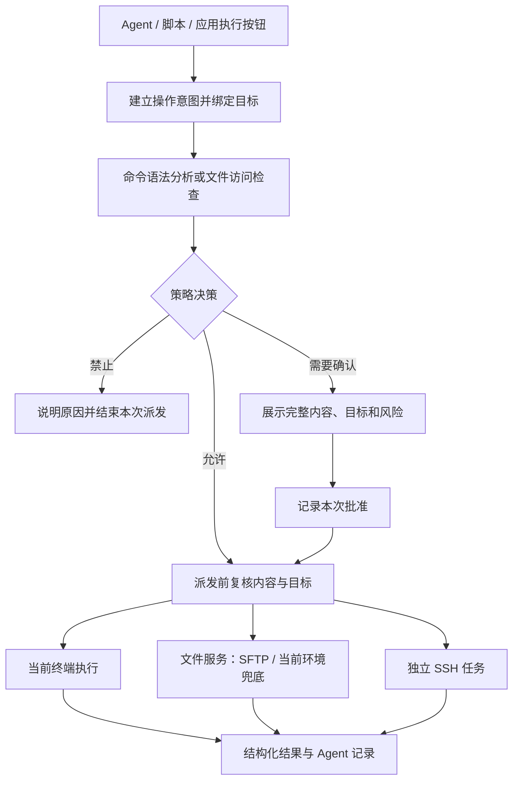

# Agent 整体优化实施方案：风险、SSH、文件与任务闭环

更新：2026-11-05。状态：M0—M11 已完成当前工作树实现、逐项要求核对及已授权环境内的适用验收。M2 多行原样派发已通过真实 Bash/Zsh PTY 与 Linux/Bash SSH；M5 覆盖用户提供的直连 SSH 和本机 macOS。风险/授权、文件服务及编辑恢复、独立 SSH、验证、计划、检查点、任务脚本和主机知识均有原生、运行时及适用 UI 证据。新增本机配置→检查→重载→HTTP→中断恢复→脚本来源联合验收通过。Windows、远端 macOS、真实跳板/菜单/容器等未提供环境不记为实测；默认模型网关中断也保留为未完成记录。完整索引见 [要求核对](agent-completion-audit-2026-11-05.md) 和 [真实环境验收](agent-live-acceptance-2026-11-05.md)。以下实施记录按发生顺序保留，其中早期“待完成”由后续记录补齐。

本次 M0 实施记录：

- 风险检查与 Agent 授权复用 `shared/security/shellCommandScan.ts`，按完整输入处理续行、引号拼接及原始行号；同类风险保留各命令的命中，摘要取最高等级。
- 解释器、命令替换、heredoc、未支持的分组和 ANSI-C 转义进入逐次审查；补齐 `env -S`、`find -exec`、`rg --pre` 和带引号的子命令检查。
- 风险命令不能通过已有前缀允许项或精确命令授权自动执行；精确授权在使用时也重新检查资格。动态命令不再提供可复用的精确授权。
- 增加 128 Ki 字符分析上限；超限不返回安全结论，同时保守保留敏感输出保护，无法确认后缀语法时不追加哨兵。
- 新增纯字符串语料和 Agent、脚本实际审批入口测试；脚本检查原文，用户确认后才生成执行包装。测试中的危险样例没有交给真实 Shell 执行。
- 本地验证：AI 测试 208/208、脚本及关联测试 464/464、架构检查 4/4、UI 契约检查、构建与 AI 浏览器套件通过。并行验证时，既有 20ms 超时测试出现一次时序断言失败，单独重跑完整脚本套件通过。浏览器使用模拟模型和执行器，不代替原生后端或真实 SSH 验收。

M0 属于词法检查与现有规则的补强；完整 AST 分析、运行环境绑定和后端统一执行门禁在 M1 中推进，不能把 M0 修复视为任意 Shell 程序的安全证明。

M1 首批实施记录：

- 新增 Rust `domain/command_policy/`，接入 `tree-sitter 0.27.1`、`tree-sitter-bash 0.25.1`。依赖要求 Rust 1.90 及以上，已在 `Cargo.toml` 声明；现有发布工作流使用 stable 工具链。
- 分析完整输入的语法树，静态可取得的 `bash -lc`、`eval` 内容递归分析；补齐包装参数、重定向、Git 状态修改及解释器执行等规则。修正解析库将词内反斜杠续行视为空白的边界，风险位置映射回原始 UTF-8 字节和 UTF-16 列。
- 预算为 64 KiB 输入、32 层嵌套、32,768 个访问节点及 50ms 分析时间；解析器回调和树遍历共同检查预算，超限不自动放行。尚未支持的方言、外部脚本和运行时展开保持未知。语法分析完成不等于程序行为已获安全证明。
- 新增目标、分析、批准、取消和派发 IPC，以及对应 TypeScript 类型和 infrastructure 适配。待执行内容由后端保存；批准绑定精确源码、操作类型、会话实例、连接配置版本、环境版本和策略版本。记录最多保留 5 分钟、每会话最多 16 项。
- 复核、消费批准和写入在同一会话锁内进行；原始输入、环境报告变化、重连、连接配置修改或删除使旧记录失效。写入失败也消费批准，不能用同一记录重试。Bash 脚本包装由后端从已审查源码生成。
- 当前环境字段是应用上报的信息，不等于已经验证真实主机、容器或提权后的身份。缺失字段保持未知；Shell 能力和环境的自动探测尚未接入。
- 本地验证：新增 22 项策略与派发相关测试；完整 Rust 测试 268 项通过、15 项按仓库配置忽略；`cargo check`、`cargo fmt --check`、前端构建、架构检查和 UI 契约检查通过。危险命令语料只进入分析器或记录字节的模拟终端。

M1 第二批实施记录：

- Agent 异步取得后端分析，`ask`/`deny` 不能被前端只读允许项或历史授权覆盖。后端拒绝、分析失败及批准失败均终止本次派发；执行票据仅驻留内存，不进入消息或检查点。失败重试重新进入分析和审批。
- 脚本与应用命令通过 `createApplicationCommandExecutor` 分析原始内容，统一展示完整源码、原目标、风险与未知原因；多目标逐一绑定，用户改变当前选择不会把旧批准移到新目标。确认后等待实际队列写入结果，部分失败不重放。
- `TerminalPane` 的应用命令队列消费后端票据；按键与协议数据仍使用原始输入。策略过期或拒绝不会直接把健康连接标成断开。旧脚本原始写入事件在生产路由关闭。
- 捕获包装随意图在后端生成：已选标记模式保留原命令，哨兵模式使用固定、引用后的当前 Shell `eval` 模板，保留目录和环境修改语义，并支持末尾注释和多行源码。包装不是新的授权内容，也不能由调用方在批准后替换。
- 新增类型化捕获探针、环境报告探针和文件快照。类型不接受任意命令字段；固定只读探针保留同一环境中的待执行批准，探针写入失败则使其失效。文件请求检查数量、绝对路径、控制字符和敏感路径，并在脚本中再次检查解析后的父目录。
- 环境报告仅表示当前 Shell 返回的信息，不是 SFTP 映射或远端身份的独立证明。Shell 标记能力的完整闭环验证属于下一阶段 M2；现有文件传输通道继续在 M3/M6 中收敛为受控文件服务。
- 当前本地验证：前端脚本及关联测试 476 项通过，包含新增多目标与实际审批链测试；后端策略与派发定向测试 24 项通过，前端构建、UI 契约、架构检查通过。后端全量回归与浏览器集成仍在进行；这些结果不代替真实 SSH 验收。

2026-11-04 续接会话实施记录（来源会话 `01a1a47f-216c-7a30-b337-00c4e3a3a661`）：

- 核对中断前的完成输出：M1 全量 Rust 测试 271 项通过、15 项忽略；命令审批及 AI 浏览器套件已通过。上面的“正在进行”是中断时的记录，现已收尾。
- SSH 在已连接且提示符空闲时验证既有集成，必要时通过后端固定操作加载当前会话钩子，不改写远端文件。连接编辑器增加自动加载开关，SQLite 与旧 JSON 配置缺省为启用；内部操作保留界面焦点。
- 只有随机探针的完整 `C → 输出 → D;7 → A → B` 链路才能启用标记捕获。验证读取显示过滤之前的原始流，支持 OSC 133 和兼容的 OSC 633；提示符标记和历史 `sawMarkers` 不再作为能力证明。输入、应用命令派发、重连和捕获异常使结论失效；迟到的探针不能补发到新目标。
- 固定钩子加载与只读探针分开建模：加载钩子会使旧审批失效。Bash 4.4 以下不安装不完整钩子；现代 Bash 保留 `PROMPT_COMMAND` 数组与原退出状态；Zsh 重复加载不叠加钩子。加载脚本采用单行编码，修复真实 PTY 中多层引用、多行安装载荷损坏的问题。
- 哨兵显示过滤仅处理本次随机标记，以及能够精确确认的包装回显；未知回显、普通输出和相似标记保留，调试模式透传。过滤有长度和时间边界，用户输入与重连释放状态。
- 已用真实本机 PTY 验证 Zsh 5.9、系统 Bash 3.2 的回退，以及在临时目录编译的 Bash 5.2.37；覆盖非零退出码、已有钩子、数组提示符、重复加载和多行最终状态。没有连接业务 SSH 主机，也没有把本机测试记为 SSH 真机验收。
- 本批验证：前端脚本及关联测试 486 项通过，UI 契约、架构与构建通过；Rust 全量 276 项通过、15 项忽略，随后增加多行用例的真实 Shell PTY 定向套件 4 项通过；`cargo check`、格式检查通过。实际 AppShell/xterm 的终端浏览器套件 16 项通过，命令审批浏览器套件通过，原生边界使用模拟 IPC。既有 20ms 倒计时测试的断言改为核验“用户选择继续后有完整的新等待周期”，避免依赖 Node 定时器与墙上时钟恰好同步。
- M2 待完成边界：多行命令目前固定使用哨兵模板，避免多次 readline 执行导致提前结束；原样多行派发需要进一步协商 bracketed paste。未支持的 Shell、无法验证的能力继续回退；真实 SSH 的版本、主题、断线和内层环境矩阵仍待验收。

M3 实施记录：

- 新增共用的有界文件服务，接通本地文件、独立 SFTP 句柄和当前终端固定只读读取。环境证据不足时仅在当前终端读取；权限不足、文件缺失或读取开始后的异常不会触发换账号、换路由或换环境。
- 文件检查、敏感路径批准、派发、结果和分页游标均绑定会话、路径、解析目标和版本；旧结果不能跨输入、配置修改或重连生效。批准由后端单次消费，模型不能构造内部脚本或敏感授权。
- 读取保留 UTF-8 BOM、CRLF、空白和末尾换行；单次内容至多 64 KiB、扫描至多 1 MiB，目录至多 500 项并受字节与扫描预算约束。游标检测版本及目录前缀变化。libssh2 可能额外预取有界的 32 KiB；元数据版本是变化提示，不是原子快照保证。
- Agent 接入 `read_file`、`list_directory` 和独立文件卡片；敏感读取逐次确认，内容仅发送到当前模型，不持久化到会话。上下文限制与后端读取预算分开处理，不以省略内容后的游标跳过模型未见的片段。
- 完整文件快照复用文件服务，保留 64 KiB 单文件、256 KiB 单批与现有任务预算；部分、变化中、编码不支持或环境不明的结果不能成为完整 diff 基线。经验证的缺失结果带当前环境范围。
- 当前终端新文件工具要求 Python 3，支持 POSIX Linux/macOS；缺少 Python 或无法确认环境时明确不可用。既有 POSIX 快照读取仍可回退。原生 Linux 映射依赖 boot/mount/root/身份/安全上下文证据，受限或不可读时回退当前终端；Darwin 本地映射核对根目录与进程身份，远端 Darwin SFTP 尚不建立映射。Windows 和其他 Shell 不借用未经验证的本地/登录环境。
- 验证：前端脚本及关联测试 497 项、AI 测试 221 项、传输测试 88 项通过；构建、架构、UI 契约通过。Rust 全量 300 项通过、19 项忽略，随后新增的目录/缺失快照与模型工具契约定向测试通过；格式及编译检查通过。隔离 loopback SFTP 协议测试 19/19 通过，真实 Bash/Zsh PTY 文件传输通过，AI 浏览器文件流程及终端浏览器 16 项通过。
- 浏览器模型与 IPC 使用替身，SFTP 为隔离测试服务；这些记录不代替业务 SSH、跨平台或真实模型调用验收。

M4 实施记录（2026-11-05 续接会话 `01a1a5ae-e81b-7912-9b49-f16b4d145856`）：

- 完成独立 SSH 任务后端与 Agent `run_ssh_task` 接线。任务使用独立传输、`/bin/sh`、明确的绝对目录以及清空后显式设置的环境（缺省 PATH），不继承交互终端的目录、变量、提权或容器。交互菜单路由不启用该工具。
- 后端分析原命令并逐次批准；批准绑定源码、目录、环境、登录目标、连接配置和会话版本，派发时单次消费。Agent 不将独立任务加入命令允许列表，也不在失败后改用 PTY 执行。
- 同时读取 stdout/stderr，按 UTF-8 字符边界处理分包；总输出保留上限为 64 KiB，超过后继续排空通道。模型单轮每条流至多发送 4000 字符，并明确上下文截断。
- 修正 libssh2 缺失 exit-status 时可能返回 0 的语义：固定包装的随机结束记录与通道关闭共同证明退出状态；缺少证据、断线或观察超时均不报告成功。停止观察不承诺终止远端进程；效果未知的任务禁止直接重试。
- 前端展示登录目标、工作目录、实际环境、分离输出及停止观察入口。事件只唤醒状态读取，定期快照恢复漏事件；派发确认丢失只读取已有任务，不重发 exec。敏感环境和输出不进入持久化历史，旧命令记录仍可恢复。
- 修复中断时遗留的 macOS 临时目录符号链接断言，以及浏览器发现的停止按钮路由问题。验证：SSH 单元与隔离 loopback exec 协议 6/6 通过；完整 Rust 回归 307 项通过、21 项按配置忽略；前端关联回归 509 项通过，随后新增停止竞态后的 SSH 定向套件 13/13 通过；构建、架构、UI 契约和完整 AI 浏览器套件通过。浏览器覆盖敏感任务批准、实际点击停止观察、输出查看与历史脱敏。
- 隔离 SSH 服务与模拟模型不代替业务 SSH、真实模型或跨平台验收。当前独立任务状态驻留内存；重启恢复由 M9 接续。远端进程终止、原 PTY 重接和远端辅助进程均未被宣称已实现。

M7/M8 实施记录（2026-11-05）：

- 新增 `record_verification`：声明检查目的、必要性、预期结果和证据步骤，由应用根据实际输出包含关系、文件内容或已知退出码计算状态。模型不能直接传入“通过”覆盖计算结果；不存在的步骤、未知退出、读取期间文件变化或无法证明缺失的截断输出不会被填为成功。
- 任务结果独立记录为已验证、部分完成、尚未验证或验证失败。必要检查失败优先显示验证失败；只有进程退出检查不能独立得到“已验证”；计划仍有未完成项时也不能显示全部验证完成。该结果针对任务声明的检查，不宣称能自动理解并证明任意业务目标。
- 潜在写操作派发后使之前的观察失效，重新引用写入前证据也不能将其伪装为最新结果。验证仍通过原命令/文件工具执行，不增加绕过审批的通道。
- 新增 `update_plan`：保留稳定 ID、计划版本、调整原因和真实步骤关联；最多 12 项，一次至多一个进行项，完成项必须引用确已成功完成的步骤。跳过、取消、等待和失败分别记录，简单任务不强制建计划。
- 任务界面展示计划、调整记录、必要/补充验证项及原始步骤依据。持久化保存计划和验证元数据，敏感预期与敏感证据脱敏，旧记录缺少字段时保留历史行为。
- 每轮模型请求携带当前计划与验证摘要，旧工具轮次压缩不删除当前计划事实；后续会话与会话摘要也接收有限的计划/验证证据。原始目标继续由任务固定快照提供。检查点派发边界、应用重启后续跑及用户新输入后的现场核验仍属于 M9，未伪装成已实现的恢复能力。
- 验证：前端关联回归 517 项通过；随后补充必要/补充检查用例后 AI 套件 236 项通过、任务进度定向 9 项通过（包含转义内容导致摘要膨胀的预算回归）；后端模型协议 31 项通过；构建、编译、格式、架构和 UI 契约通过。完整 AI 浏览器套件覆盖计划跨轮次/重新打开、退出 0 但 HTTP 503 的验证失败、原始证据查看及 SSH/M3 既有流程。

M6 文件编辑闭环实施记录（2026-11-05）：

- 完整、稳定、未截断的 UTF-8 读取可以取得仅在当前会话内有效的基线 ID；读取字节数与文件长度不符、部分读取、读取中变化及超限结果均不能生成编辑基线。缺失文件经当前终端核验后可生成创建基线。基线有期限和数量上限，目标失效时清除；持久化会话不保留基线 ID。
- 新增精确文本替换、完整写入、删除及恢复提案。每条原文必须恰好匹配一次；后端保留拟议前后全文、路径、实际提供方、目标与写入策略，以哈希绑定一次性差异审批，IPC 不接受可自行构造的执行许可。前后内容各最多 64 KiB；模型不能提供替代基线或 Shell 写入代码。
- 本地和当前终端写入在派发前复核环境、解析路径、元数据版本和完整内容，使用同目录临时文件，保留权限和现有扩展属性后替换并回读核验；硬链接文件不按单一路径替换。创建使用不可覆盖已有目标的排他操作。终端写入由单独的、只能从已消费审批生成的固定辅助程序执行，不进入可反序列化的只读 probe 分支。
- SFTP 保持原读取提供方与路由，重新比较完整内容后原位写入，保留原文件对象及其既有元数据。当前依赖的 SFTP rename 标志不能要求原子覆盖，因而明确标记 `in-place`；不宣称原子性，不以删除旧文件模拟重命名，也不在派发后改用另一提供方。大小调整、关闭回执或回读失败均保留未知效果，不自动重发。
- 新增 SQLite 文件变更记录，派发前保存完整前后内容；读取到仅有派发记录、缺少可信结果的操作时显示未知，不视为可重试队列。本地/SFTP 工作者在观察超时或取消后仍保存最终结果；终端观察取消后保留未知记录。敏感文件前后内容不持久化，不提供基于该持久记录的恢复。
- 恢复先重新读取当前文件或核验缺失，再对比该次写入后的内容、版本和环境，生成新的逆向提案并重新审批。外部修改导致冲突；创建、修改、删除各有不同逆向动作。本地/当前终端记录有界的 mode/uid/gid、ACL 与扩展属性备份，恢复前核验平台与完整备份，恢复后逐项核对。SFTP 无法证明完整 ACL/扩展属性时不提供删除后的自动恢复；备份超限或不完整也不会放宽该条件。
- 验证：完整 Rust 回归 318 项通过、22 项按配置忽略；本地/终端编辑与应用派发定向 15 项通过；隔离 SFTP 映射、取消与写入协议 3 项通过，覆盖外部改动、权限保留以及关闭回执丢失后仅写一次。AI 回归 237 项、前端构建、架构 4 项及 UI 契约通过；新基线 ID 不落入持久历史，模型未看到完整内容时也不给出基线 ID。
- Agent 接通 `apply_patch`、`write_file`、`delete_file`、`restore_file`；同时具备文件读取与编辑服务才向模型提供。每批 1—8 个文件，整批展示后端生成的精确前后差异并逐次批准，再顺序写入。不能生成 Shell 允许项，也不能把基线引用或差异审批票据持久化。
- 多文件中途冲突保留已写入项，剩余项保持未开始；效果未知即停止任务和后续写入。历史与模型摘要保留逐文件状态和变更 ID，大批量写入全文不会挤爆下一轮请求。潜在文件写入使旧验证证据失效，部分/未知结果不能用于完成计划项。
- 每条成功、非敏感变更提供恢复入口；点击后固定执行重新读取/核验缺失、生成逆向提案、展示差异和重新批准，无需模型决定恢复内容。外部改动时明确冲突。敏感文件的前后正文及扩展属性备份不进入持久历史。
- 最终本地验证：前端关联测试 534/534、传输测试 91/91、架构 4/4、UI 契约与构建通过；Rust 全量 320 项通过、22 项按配置忽略；隔离 SFTP 定向 3/3 通过。完整 AI 浏览器套件覆盖窄面板精确差异、三文件第二项失败、重新打开保留部分结果、重新批准恢复、外部改动阻止恢复及敏感历史脱敏；本机权限测试覆盖 ACL/扩展属性保留与删除后恢复。浏览器模型和 IPC 使用替身，上述回归不代替业务 SSH、真实模型或跨平台验收。

M9 第一批实施记录（2026-11-05）：

- 新增独立的 SQLite 运行检查点，以 `runId`、步骤 ID 与递增序号记录目标、计划、步骤阶段、结果及文件变更引用。使用明确的持久类型，拒绝多余配置/授权字段；不序列化模型配置、API key、SSH 环境变量、终端快照、文件基线或审批票据。敏感命令/输出与文件正文在前后端投影中脱敏。
- 在人工审批前、派发请求前、开始观察、取得结果、逐文件写入结果以及任务结束时保存；派发前的保存必须确认完成。保存失败或回执超时后停止后续派发，不重发存储请求或操作。停止和保存同时发生时按序保存终态，迟到的准备结果不会再启动模型或命令。
- `before-dispatch` 表示已保存派发意图，`observing` 表示应用开始观察；两者都不冒充远端实际完成回执。崩溃留下这些阶段且没有可信结果时，界面显示效果未知。M6 的独立文件变更日志继续保留写入前记录和原生最终回执，可供下一批恢复核验使用。
- 每个运行持有 OS 文件锁，覆盖审批和观察等待；重复窗口、其他进程和旧内存所有者不能抢写同一运行，进程退出自动释放锁，不设置可能在写入中途到期的时间租约。保存检查递增序号；重连后禁止继续派发，但仍允许记录原任务已取得的结果。
- AI 面板按连接与对话发现并展示已保存的未完成任务、既有计划、命令结果和逐文件变更引用。打开记录只读，不启动模型或重放命令。新表兼容旧数据库；没有检查点的旧消息继续使用原历史展示。
- 本批验证：前端关联回归 543 项通过，补充启动取消后的运行态定向 75 项通过；完整 Rust 回归 324 项通过、22 项按配置忽略；新增 4 项原生检查点测试覆盖重启、锁、旧序号、重连和敏感数据边界。构建、格式、架构及 UI 契约通过；完整 AI 浏览器套件覆盖真实面板的检查点接线与重新打开后的未知状态展示，IPC/模型仍为替身。
- 此批交付每步保存和发现入口，尚未交付同一运行的重新取得所有权、重新核对目标/路径/服务、未知效果对账与受控续跑。检查点保留的是历史事实；恢复时还需重新建立路由与环境证据、读取文件、重建未完成计划，并重新审批，不能把当前记录视为可执行队列。

M9 第二批实施记录（2026-11-05）：

- 同一运行可以重新取得新的内存所有权和 OS 文件锁，按数据库序号继续保存；重复窗口、旧所有者、重复确认和旧序号不能消费新运行。核对原连接路由与当前会话报告的账号、主机/容器环境标识；证据缺失、账号/环境或路由变化时停止恢复。目录变化明确展示，由用户依据当前目录确认继续，不自动切回旧目录或恢复环境变量。环境标识是当前 Shell 报告的比较依据，不宣称密码学主机证明。
- 恢复分为只读检查和确认后继续两个阶段。先读取独立文件变更日志，补回已有的可信写入结果，保留多文件部分完成；其余未知写入自动重新读取相关文件。只读阶段不提供文件修改或独立 SSH 工具，循环和后端检查点都阻止修改/未知命令，常规命令策略仍生效。中断的纯读取无需当作写入效果核对。
- 用户逐项选择本次新取得的只读依据并记录现场结论，再确认当前目标。后端核对依据来自本次会话和环境、已实际完成且不是中断前记录；未知文件写入还要求同路径同环境的完整稳定读取或已验证的不存在。一般命令效果由用户结合新检查确认，应用不声称能从任意文本自动证明业务效果，也不补造原进程退出码。
- 确认后重建原目标、计划、历史步骤与核对结论，后续命令重新人工批准，文件修改仍重新读取并展示差异。历史步骤在后端保持不可变，不能被重复步骤 ID 重新派发；旧 API key、SSH 环境、文件基线和批准不恢复。用户也可补充信息继续只读检查或停止观察。
- 恢复确认与普通保存使用同一串行序号队列；停止与确认竞争时不会覆盖新序号或晚到续跑，确认回执丢失使后续保存失败而不是重试。核对结论独立保留，后续重启不要求再次补齐已核对的原未知效果；敏感依据对应的结论脱敏。原始未知记录继续保留，不改写为成功。
- 会话与界面保留核对结论，后续提问和摘要可引用这些当时的观察。恢复历史只向模型提供明确标注的参数/输出片段，完整事实留在应用；计划和恢复摘要合计不超过模型的上下文预算。无路由证据的旧检查点保留只读历史，不伪造恢复能力。
- 本地验证：前端关联回归 550/550、运行态定向 71/71、检查点定向 11/11；完整 Rust 回归 328 项通过、22 项按配置忽略，原生检查点套件 8/8。覆盖重新取得所有权、环境/路由不匹配、旧证据拒绝、文件读取范围核对、写入回执补回、多文件部分状态、确认/停止竞态以及未完成计划发现。构建、格式、架构与 UI 契约通过；完整 AI 浏览器套件验证恢复入口、核对表单、窄面板、新审批和重新打开后的结论。浏览器模型与 IPC 为替身，不代替业务 SSH、真实模型或跨平台验收。

M10 任务转脚本实施记录（2026-11-05）：

- 完成任务的“整理为脚本”入口按连接、会话、消息从独立检查点取回已结束记录，不根据模型文本补造成功步骤。用户选择同一主机/账号/路由/容器范围内的成功命令，原步骤顺序保持不变。失败、跳过、退出状态未知、敏感命令和缺少环境证据的步骤不能自动转换。
- 在当前支持范围内确定性整理 Bash 草稿，提取工作目录、显式 `cd` 目录和常见 `systemctl` / `service` 服务名，生成类型、默认值和必填信息。每步显式进入原目录，失败时退出；跨目录依赖可见。运行时变量、会话状态操作、复杂结构、文件工具及独立 SSH 环境的步骤明确显示需人工整理，不能直接拼成假定单一环境的脚本。用户选择的是命令子集，草稿明确提示未包含的文件准备等依赖。
- 参数标识必须独立占据未引用的命令参数位置，不能作为命令名、嵌入已有引号或 heredoc。普通值经单引号引用后再进入完整脚本风险分析；服务名拒绝选项/命令形态，目录必须为绝对路径。凭据参数只生成 `AI_TERM_SECRET_*` 环境变量的带检查引用，不将凭据值嵌入代码、默认值或分享模板；使用前需在目标环境独立准备。
- AI 工作区通过真实 `WorkspacePanel` 路由创建新的脚本文档，保留已有草稿和文档编辑。生成与保存均不执行、不给命令添加允许项，也不调用模型重新编造源命令。编辑器显示来源运行、所选步骤、环境假设、参数、前置条件和关联的历史验证；历史验证作为需再次核对的要求，不冒充新脚本运行结果。
- 脚本库增加可选类型化来源元数据及 SQLite 列迁移，旧脚本缺省不含新字段。内容变化递增脚本版本，保存再打开保留来源和默认参数；当次参数输入仅驻留内存，保存和复制保留模板。改变参数后重新生成完整实际脚本，再走现有 M1 目标分析与审批，原任务或旧参数的批准不能复用。
- 验证：前端关联回归 556/556、脚本定向 36/36；Rust 全量 330 项通过、22 项按配置忽略，存储/迁移定向 13/13。真实本机 Bash 测试证明空格、引号、命令替换形态的参数仍是字面量，不会创建注入样例中的文件。新工作区浏览器套件覆盖生成、保存、运行前参数渲染、参数变化后再次审查及重新打开；完整 AI 浏览器回归、构建、架构和 UI 契约通过。浏览器的命令、模型和数据库边界使用替身，不向业务主机执行测试脚本。

M11 主机专属上下文实施记录（2026-11-05）：

- 新增独立 SQLite 知识表及类型化 CRUD，保存服务目录、配置/日志路径、部署/验证方法、来源、确认时间、有效性与记录版本。旧数据库自动建立新表；旧消息和配置不需要补造知识。每个连接最多 200 条，单条标题 80 字、内容 600 字，版本比较阻止旧窗口覆盖或删除更新后的记录。
- 适用范围由后端当前执行目标和去除凭据的连接路由共同生成，包含连接 ID、路由、实际账号和 Shell 报告的主机/容器标识，不按显示名称或工作目录猜测。未知环境不能保存或注入；账号、容器、服务器路由变化后，旧记录仍可查看删除，但不能作为当前知识使用或原位改绑。环境标识沿用 M1 的报告证据，不宣称密码学身份验证。
- AI 面板新增可查看、编辑、删除的主机知识入口，也可从已完成任务选择路径/命令候选。候选仅提取同环境成功步骤的路径或方法，保存必须由用户确认；原生端再次检查来源步骤、执行状态、实际目标与值的一致性，不导入工具输出、文件正文、批准或恢复票据。修改候选内容后转为用户手动来源。后端拒绝已识别的凭据、敏感路径、环境赋值及多行正文形态；表单明确限定简短路径/方法，不作为秘密存储。
- 普通对话及 Agent 每次模型请求前读取最新知识，根据问题的英文标识及中文双字词选择相关条目，最多 8 条、JSON 总计最多 4000 字。独立上下文字段不进入持久会话摘要，并标明数据来源、当前快照、适用范围、需核验和不授予执行权限。旧对话不是知识库；删除或修改后下一请求读取最新记录。模型请求按已有预算独立核验知识大小并计入上下文统计。
- 仅终端上下文“自动”且模型配置为 `active-command-output` 时附加；“仅选区”“不发送”及模型的选区/手动策略均关闭自动知识读取。聊天读取仅查看已有目标，不向终端隐式派发探针；显式“核对当前环境”复用原有固定探测通道，执行任务期间禁用该按钮。知识读取有 5 秒边界，失败时明确撤回旧知识；迟到结果、停止和连接变化不能继续向模型派发旧上下文。
- Agent 新一轮读取知识前核对本次运行的已保存观察。当前会话同环境文件检查确认不存在时标为失效；实际解析路径或文件环境不同、同一方法执行非零时标为待确认。无效条目保留状态和依据，但不再发送旧值；自动观察不重新激活知识。用户重新确认后，同一已处理步骤不重复撤销确认；其他无法自动判断的语义冲突可在管理入口手动调整有效性。路径和服务状态仍需按任务进行现场验证，知识不改变 M1 审批流程。
- 验证：前端全量关联回归 565/565，新增读取超时保护后的知识/会话运行态定向 81/81；Rust 全量 338 项通过、22 项按配置忽略，其中 6 项知识存储/原生 API 测试、2 项 Chat/Agent 协议测试。覆盖持久化、版本冲突、环境/路由隔离、凭据形态拒绝、来源检查、最新缺失/路径变化/失败方法、用户重新确认、编辑删除、隐私策略、迟到结果与停止。构建、类型、格式、架构 4/4、UI 契约及完整 AI 浏览器回归通过；新增浏览器套件通过真实 AiPanel 的候选确认、实际聊天请求、编辑删除、环境切换及 360px 展示。浏览器模型与数据库边界为替身，不代替业务 SSH 或真实模型验收。

M2 多行原样派发补齐（2026-11-05）：

- 增加独立的括号粘贴能力探测：先证明原有完整捕获链，再要求当前 xterm 的 DECSET 2004 模式开启，通过实际多行输入验证两个输出、单一最终退出状态及新提示符。探针只运行固定的 printf/子 Shell 程序，不改变远端启动文件或强制开启用户的粘贴设置。探测按会话与输入代次缓存，输入、重连和实际应用命令使旧结论失效。
- 后端新增 `bracketed` 传输。已协商的 Bash/Zsh 命令只在完整原文外增加粘贴起止序列和提交回车；不改写源命令或塞入 eval。原文及传输均在审批前固定，派发仍消费同一目标的单次记录。原文中的 ESC、回车和控制字符不能伪造粘贴结束；Tab 仅在可靠括号粘贴或已有脚本入口允许。
- 未取得多行证明时，支持的 POSIX 终端继续使用已审查的哨兵 eval 模板。普通应用命令的多行输入也走该选择流程，不再逐行直接输入。未知/未支持 Shell 的多行命令明确不可用。准备、进入队列及实际队列派发前都核对粘贴模式；模式关闭时停止，不能把旧批准改成其他传输后自动发送。
- 真实 PTY 实验确认 Bash 5.2 对一个多行粘贴可产生多个 PS0/C，但只在整段结束发 D；Zsh 为一个 C/D。捕获器保留第一个输出锚点、命令和计时，直到最终 D 收尾。屏幕重建支持逻辑换行；应用派发的命令历史使用已审查原文，避免把 Tab 渲染成空格后的文本用于复用。捕获串扰检查继续使用观察到的命令，不把来源归属当作新的执行证据。
- 验证：前端关联回归 571/571，Rust 全量 340 项通过、22 项按配置忽略；原生派发 12/12。真实 Bash 5.2.37 与 Zsh 5.9 测试覆盖空行、注释、引号内换行、中文、Tab、最终非零状态及当前 Shell 目录/变量保留。Zsh 默认未启用交互注释时的报错原样保留，不替用户更改 Shell 语义。真实 PTY 流按碎片重放到实际 xterm，验证完整输出、单次结果与原文历史；实际 AppShell/TerminalPane 浏览器套件 17/17，包含协商、捕获、模式关闭后拒绝派发。命令审批浏览器、构建、格式、架构与 UI 契约通过。浏览器 IPC 为替身，真实 PTY 为本机，不冒充 SSH 真机结果。
- 可复验：设置 `AI_TERM_TEST_BASH` 指向可用的现代 Bash、`AI_TERM_CAPTURE_REPLAY_FILE` 指向临时 JSON 文件，执行 `cargo test --test shell_capture_integration negotiated_bracketed`；随后以相同回放文件执行 `npm run test:bracketed-capture-browser`（需 Vite 与 CDP）。

M11 时间有效性验收补项（2026-11-05）：

- 按第 10 节“知识过期”验收补齐确认后的有效期：默认 90 天，可在管理界面选择 1—365 天。查看列表及每次模型读取都按当前时间检查，到期自动标为待确认并停止发送旧值；读取、成功工具观察和打开界面都不延长期限，重新核验并由用户确认才产生新有效期。
- 旧记录缺少有效期时，按其原确认时间加默认 90 天迁移，不从应用重开时间重新起算；没有确认时间的有效记录转为待确认。自动迁移/过期递增版本，旧窗口不能覆盖状态。新增原生测试覆盖过期撤回、旧记录迁移、版本冲突、再次确认及无效期限，知识原生 7/7、前端定向 7/7，浏览器验证所选期限进入保存记录，类型检查通过。

M5 指定主机真机验收（2026-11-05）：

- 使用保存连接及系统凭据、已有主机密钥记录，原配置数据库只读，仅复制所需行到私有临时数据库。所有远端写入只涉及随机临时目录中的验收文件，完成及失败后均清理。
- 通过真实 Linux/Bash 5.2 SSH 验证输出/错误流、退出码、多行原文、当前目录保持，以及真实流在浏览器 xterm 中的完整捕获。通过 SFTP 与关闭 SFTP 后的当前终端两条文件读取、补丁、恢复和外部改动冲突路径。
- 真机发现写入的完整 SFTP 复核需要约 27—39 秒，超出原 20 秒时限。写入观察调整为 60 秒、前端 65 秒；读取仍为 20 秒，取消、持久回执和不重放规则保持有效。补充慢回执、超时未知和取消回归。
- deepseek-flash 在 4 轮、3 次真实工具调用中完成读取、精确补丁和重新读取核验，只发生一次文件写入。默认 gpt-6-astra 已完成读取及补丁，但后续网关流中断，明确记为未完成，不重试原写入。
- 本批前端关联回归 573/573、AI 275/275；Rust 全量 343 项通过、25 项默认忽略，编译、格式、前端构建、架构、UI 契约和真实 SSH 流浏览器验证通过。完整边界、命令和环境矩阵见 [真机验收记录](agent-live-acceptance-2026-11-05.md)。该模型测试调用生产模型协议及原生服务，不冒充完整 Tauri UI 或真实业务服务重载。

M10 文件步骤与核验转换补齐（2026-11-05）：

- 从检查点引用读取真实持久文件变更回执，逐项比较变更 ID、原执行目标/会话版本、路径、文件范围、版本和成功状态。缺失、失败、未知或跨目标记录不能提供可转换正文。加载只读、有数量和并发界限；切换工作区或卸载后迟到结果不再打开旧任务草稿。
- 新建、修改、删除和纯内容恢复可与成功 Shell 命令按原顺序整理；完整、稳定的 `read_file` 记录生成实际的全文核验步骤，M7 验证项与来源保留。同一路径共用参数；未完整读取、部分成功批次和包含属主/权限/ACL 变化的恢复仍显式不可转换。
- 生成独立的 Bash/Python 3 脚本，写入前比较完整字节，拒绝基线变化、路径替换、符号链接和写入硬链接；创建使用排他打开。文本替换原位写入以保留现有文件对象属性，写后同步并回读。已匹配目标内容或已经删除时不重复写；多文件失败停止后续步骤，保留已发生的修改，不宣称原子回滚。
- 普通内容用 JSON 参数保留 BOM、CRLF、Tab 和末尾换行。敏感路径、已脱敏回执或识别出凭据形态的内容不复制入草稿，改为 `AI_TERM_SECRET_FILE_BEFORE_*` / `AI_TERM_SECRET_FILE_AFTER_*` 指定的目标端 UTF-8 输入文件；其默认值为空，生成内容、来源和验证摘要不保存原敏感值。输入文件只做有界读取，核验不打印内容。
- 脚本来源、步骤、参数和验证项继续使用现有持久格式；保存/复制保留模板，运行时才安全引用参数，并重新进入完整脚本与当前目标的 M1 分析。原任务的基线、审批和恢复能力不进入脚本。创建采用原记录 mode 与当前账号，权限或扩展属性恢复不能悄悄省略为内容转换。
- 验证：前端关联回归 582/582，脚本定向 14/14；真实本机 Bash 覆盖逐字节读改读、重复执行、创建/删除、外部冲突、多文件部分完成、符号/硬链接拒绝、敏感内容外部输入及记录绑定。工作区浏览器覆盖三种步骤选择、保存、参数替换后审查、重新打开、文件参数共用及脱敏输入提示；构建、类型、架构 4/4、UI 契约和空白检查通过。浏览器 IPC 使用替身；本批未把它记为新的 SSH 真机脚本验收。

M10 复杂 Bash 与命令凭据模板补齐（2026-11-05）：

- 在后端分析真实命令时生成有界、无批准能力的脚本来源。Bash/POSIX 的完整 AST 可保留赋值、函数、循环、管道、命令替换和 heredoc；交互控制、语法不完整、保留标识、未支持的方言以及不能可靠分离的敏感结构不生成来源。此能力不是任意程序的敏感数据识别器，凭据转换只覆盖明确识别的结构。
- 识别凭据变量、命令选项、常见 CLI 短选项、认证头、含凭据的 URL 和私钥字面量；在离开待执行记录前替换为外部输入引用。重复敏感字面量一并处理，嵌入解释器、数组、heredoc 或其他不能可靠分离的敏感片段不返回部分模板。只保存变量名及说明，不保存凭据默认值；超时、字节、节点、深度或 32 项输入预算超限均不复制部分源码。
- Agent 在 prepared/before-dispatch 检查点附带内存中的精确命令引用。原生端核对运行所有权、当前目标、操作种类、命令内容和未过期记录，保存后即丢弃引用。后续更新保留原生生成的来源并忽略调用方注入；敏感标记不能被后续更新降级。历史记录没有新字段时仍可读取，不从脱敏文字还原凭据或批准。
- 复杂源码通过静态引用的 `builtin eval` 在同一 Bash 进程中按步骤执行，保留所选步骤之间的变量和函数；每步恢复明确目录并保留非零退出码。普通目录/服务参数继续使用原安全替换路径，凭据使用 `AI_TERM_SECRET_COMMAND_*` 目标环境变量。填入值不拼成 eval 源码；缺少外部值时停止。路径、环境假设、遗漏依赖、验证项和来源仍在草稿中可见。
- 完整实际脚本继续经过 M1：补齐 `builtin eval` 与 `eval --` 的内层分析，禁止操作不能藏在包装中。生成、保存、重新打开不执行脚本；更换参数后仍重新审查当前目标。敏感命令相关验证说明与预期不复制原值。
- 回归发现并修复会话 payload 只隐藏输出、仍保存敏感命令及风险原文的问题；现在命令、风险原文和相关说明一起脱敏。已脱敏的历史命令带明确标记，UI、应用层和执行循环均拒绝直接重试。检查点中的敏感说明、失败详情和验证说明也不保留原文。
- 验证：前端关联回归 590/590，原生完整回归 350 项通过、25 项按配置忽略；随后增加预算用例及最终限制后的原生定向套件 30/30。真实本机 Bash 验证跨步骤状态、heredoc、凭据含引号/换行/`$()` 时仍为数据、缺失输入失败和非零退出后停止。SQLite 测试覆盖来源伪造、错目标/错命令、过期或取消引用、重启保留模板、敏感标记降级及凭据不落库。构建、类型、架构 4/4、UI 契约、格式与空白检查通过；任务脚本浏览器和完整 AI 浏览器套件通过，包含 360px 面板、保存后重新打开和新脚本运行入口。浏览器 IPC 仍为替身；本批不追加 SSH 真机脚本验收结论。

M8 回复接续、计划收尾与 M5 本地 macOS 补充（2026-11-05）：

- 回复 `ask_user` 现在通过原生 `reply_agent_run` 接续同一运行，保留原始目标、版本计划、问题/回复和执行事实；主输入框、消息内及保存任务入口均可使用。每次接续取得新的所有权，旧批准失效，先前验证降为待重新核验；换会话或仍有未知效果时先走恢复核对。敏感回复不保存原值，过期序号、重复提交、错环境和迟到结果不会新建替代任务或派发命令。
- 取消与跳过计划项不再永久计入剩余工作；UI 分别显示已完成、剩余、跳过和取消，保留调整原因与版本。必要检查缺失或失败时仍不能标为已验证。原生查询与恢复入口同步处理计划状态；模型结束后的未知命令/文件效果仍保留核对入口，取消计划不代表取消已派发的操作。
- 新增真实本地 PTY 文件验收：Zsh 和系统 Bash 均经生产 AppState 接口完成环境证据核对、Local 提供方选择、读改读、单次审批、恢复、外部冲突和 SQLite 变更记录保留；仅写独立临时目录。系统 Shell PTY 套件 6/6，指定现代 Bash 后 6/6，真实流 xterm 回放与截图通过。具体系统版本、Zsh 交互注释语义和范围见 [验收记录](agent-live-acceptance-2026-11-05.md)。本地 macOS 不替代远端 macOS SSH 或 Windows 客户端。
- 验证：前端关联 594/594、AI 282/282、Rust 全量 356 项通过及 25 项默认忽略；检查点定向 14/14、计划/检查点前端定向 24/24，完整 AI 浏览器、构建、架构 4/4、UI、格式与空白检查通过。AI 套件曾因真实计时器的毫秒边界出现一次静默时长断言失败；已改用可控时钟，验证 59ms 不超时、60ms 触发，完整套件重跑通过。
- 逐项清单见 [完整要求核对](agent-completion-audit-2026-11-05.md)。下一步补齐极长上下文紧凑分支中的计划证据引用，并核对计划中的用户确认依据；其余原始要求仍逐项比对，不能以本批测试数量替代整体完成结论。

M8 计划证据摘要与用户确认补齐（2026-11-05）：

- 修复两处紧凑分支丢失计划执行引用的问题。普通任务和恢复任务使用同一摘要结构，保留计划版本、原因摘要、状态、关键步骤 ID 及用户确认来源。历史上下文标明用户确认不等于应用执行或现场验证。引用本身超出组合预算时，保留原记录并明确停止请求，不能通过截断引用继续生成无依据结论。
- 在等待任务问题回复时提供可选的已完成事项确认，默认均不勾选。原生端绑定当前运行、目标、序号和现有事项，保存用户确认的原始描述、回复与时间，再增加计划版本。未知或重复 ID、已结束事项拒绝且不消耗等待状态。确认来源只从原生保存的回复重建；模型及普通检查点更新不能伪造或转移来源，事项描述改变后不沿用旧确认。
- 用户确认可以作为计划完成依据；实际步骤历史保持原样，未知命令/文件效果仍需核对，旧批准及验证不恢复。完成计划但没有必要检查时仍显示“尚未验证”。保存再打开后，确认标签、计划版本和来源继续存在；旧 payload 无新字段时正常读取。
- 验证：原生检查点15/15、前端计划/检查点26/26；完整前端关联596/596、AI284/284、Rust357项通过及25项默认忽略。构建、类型、架构4/4、UI、`cargo check`、格式及空白检查通过。完整 AI 浏览器验证勾选、回复、版本变化、重新打开和结果区分，截图已检查。新增历史上下文用例初次失败源于测试消息缺少必填角色/连接/终端字段，已补全真实消息结构后通过。本批没有新增 SSH 或真实模型验收结论。
- M8 四项要求已在 [核对清单](agent-completion-audit-2026-11-05.md) 标记为已核对。下一步补充 M10 保存后可追溯的逐项待整理来源，再继续其余原始要求的源码与用例审计。

M10 待整理来源、遗漏验证与静态 Zsh 补齐（2026-11-05）：

- 保存草稿时，未纳入的步骤保留稳定 ID、工具、原状态和固定原因；未纳入的验证项保留 ID、必要性及原证据引用。重新打开后可逐项查看全部来源，明确还需自行整理与重新验证；不把原命令、文件正文、验证目的/预期、凭据或批准复制到遗漏记录中。
- 单任务最多 1,000 个来源步骤，所有引用必须唯一且完整；原生同时核对遗漏验证引用确实指向未纳入步骤。元数据上限由 64 KiB 调整至 512 KiB 以保存最多 1,000 个完整引用；可执行脚本仍保持 64 KiB 上限。旧版本缺少新字段正常读取，未知原因、额外能力/正文字段、重复来源和超限都拒绝。
- 复现静态 Zsh `print` 原执行成功、Bash 草稿退出 127 的转换问题后，受支持的静态 Zsh 步骤改用 `zsh -f -c`；目录、服务等参数经位置参数进入子进程，特殊字符不成为源码。每步显式恢复目录并检查退出码。依赖原会话选项、函数加载、目录栈或后台作业的命令保留待整理原因，界面说明 Zsh 环境前提；不模拟所有交互状态。
- 本机 `/bin/zsh` 与 `/bin/bash` 实际运行验证成功、带引号和命令替换形状的目录仍为数据、失败后不继续下一步。原生对导出的 Zsh 内层仍返回未知和确认，不借复用来源免除当前策略。浏览器验证普通/敏感/复杂/Zsh 草稿生成保存不执行，改参数后提交完整脚本重新审核。
- 当前结果：前端关联 599/599、AI 284/284、Rust 360 项通过及 25 项默认忽略，构建、架构 4/4、UI、`cargo check`、任务脚本浏览器通过。原生完整日志 `/tmp/ai-term-m10-omissions-verified-native.log`，前端/构建等同前缀；浏览器 `/tmp/ai-term-m10-omissions-final-browser.log`，两张窄面板截图保留。本批没有新增 SSH 或真实模型结论。
- M10 五项要求已在核对清单中交叉检查源码、用例与执行结果；继续审计其余 M0—M11 要求。

M0/M1 门禁复核与缺口修复（2026-11-05）：

- 精确命令的会话允许记录原来只按前端连接和终端代次隔离，实际目录、账号或容器改变时仍可能沿用。现每条命令取得原生分析后核对真实目录/账号/环境范围、Shell、原生会话、连接、路由、操作与策略版本；变化或未知就清除旧记录，返回旧环境也不会恢复。只增加观测版本、实际环境不变时保留精确允许资格，原生单次审批仍绑定每次完整目标和版本。新增 7 个调用链用例先失败复现，再扩展为 9 项覆盖全部变化及未知环境。
- 补齐只读程序参数例外：本机 Bash 实测 `printf -- '%n'`、宽度/长度格式变体会给变量赋值；本机临时目录实测 `file -C -m magic` 生成 `magic.mgc` 并清理。它们不再获得前缀或精确自动允许。`rg --hostname-bin` 可执行外部程序的语义据 [官方源码](https://github.com/BurntSushi/ripgrep/blob/master/crates/core/flags/defs.rs) 核对并标记未知；未声称本机安装或执行了 rg。普通参数、`%%n` 与参数结束标记后的数据有安全对照用例。
- 长命令审批显示最高风险、实际环境与风险摘要；源码折叠保留完整内容，点击风险行会自动展开并定位。360px 测试发现沿用脚本弹窗样式会向右溢出，已在该组件限制宽度并允许底部操作换行；深浅主题截图均已检查。批准仍为本次操作，取消、重连、第二次操作及策略禁止场景均有回归。
- 全部改动与先前 M8/M10 并存，不提交或发布。最终前端关联 640/640、AI 309/309、Rust 360 项通过及 25 项默认忽略；构建、架构 4/4、UI、`cargo check`、格式及空白检查通过。记录见 `/tmp/ai-term-m01-complete-*.log`；完整 AI 与脚本浏览器记录在 `/tmp/ai-term-m01-final-ai-browser.log`、`/tmp/ai-term-m01-final-script-browser.log`，命令审批浏览器及截图路径见 `/tmp/ai-term-m1-review-browser-final.log`。这些浏览器使用原生边界替身，不扩写为真实 SSH 或完整 Tauri 联调。
- CORE、M0 五项、M1 十二项及领域归属已在 [要求核对清单](agent-completion-audit-2026-11-05.md) 对照当前源码/用例核对。M8、M10 原有核对继续有效；下一组为 M2 捕获能力、M3 文件服务、M4 独立任务，以及 M6/M7/M9/M11 和兼容/整体场景。

续接位置与未完成事项：

1. M6 本地实现与回归完成。SFTP 原位写入及缺少完整元数据备份时不支持删除恢复的限制在界面与后端一致保留。
2. M9 本地闭环完成：重新取得同一运行、比较路由/环境、只读核对未知效果、用户确认并重新审批后继续；保留原未知记录与独立核对结论。M10 已接续实现。
3. M10 已接通受支持的成功命令、文件创建/修改/删除及完整文件核验转参数脚本，复用来源/版本存储、编辑器、脚本库和审批链。敏感文件内容通过目标环境中的外部输入文件提供。受支持的复杂 Bash 和命令凭据外部输入已补齐；交互控制、无法分离的敏感结构、独立 SSH 环境和涉及权限/ACL 变化的恢复保留显式待整理状态，保存重开后仍逐项保留来源、原因及遗漏的必要验证；M10 五项交付边界已核对。
4. M11 本地实现与回归完成：按路由/实际账号/环境管理知识，每请求按问题与发送策略读取当前版本；新文件或方法观察可标记失效/待确认。未知环境不借用旧知识。
5. M2 多行原样派发已通过本机和真实 Linux/Bash SSH，并将真实流重放到 xterm 验证完整结果与历史原文。M5 已完成指定直连主机的原生 exec、SFTP/当前终端文件闭环及 deepseek-flash 真实模型工具调用；gpt-6-astra 在写入后的下一轮发生上游流中断，未记为完整通过。跨平台/路由矩阵仍按实际环境记录。
6. 继续对 M0—M11 逐项核对原始要求。M10 的文件操作、敏感文件外部输入、受支持的复杂 Bash 和命令凭据模板已补齐；独立 SSH 环境、元数据恢复及其他不可转换步骤的持久待整理提示已补齐；CORE、M0、M1、M8、M10 及领域归属已逐项核对，继续捕获能力、文件/SSH 任务、编辑恢复、验证与兼容等要求，不把受支持的转换子集表述为所有任务都可复用。

整体目标继续有效；本批未提交 Git、未发布，也未把隔离测试记为业务主机验收。

实施主线为：**修复现有风险漏判 → 统一目标绑定与执行门禁 → 远端 Shell 集成、文件工具 → 文件修改与结果验证 → 任务计划与恢复 → 脚本复用与主机上下文**。独立 SSH 命令任务按需接入，集成验收贯穿各批次。

整体方案覆盖此前讨论的全部优化：长命令风险拦截、SSH 命令与文件读取，以及修改前预览和恢复、执行后验证、任务计划、检查点恢复、任务转脚本、主机专属上下文。按阶段交付，每个阶段有独立完成门槛。

| 此前讨论的优化点 | 实施位置 | 用户得到的能力 |
| --- | --- | --- |
| 危险与长命令拦截 | M0、M1 | 准确定位危险操作，未知结构不自动放行 |
| SSH 命令执行优化 | M2、M4 | 当前终端少包装，独立任务有明确输出和退出状态 |
| Agent 文件读取 | M3 | 文件和目录工具、限量阅读、正确的主机与环境 |
| 文件编辑闭环 | M6 | 修改前 diff、版本冲突检查、修改后差异和恢复入口 |
| 任务结果验证 | M7 | 区分已验证、部分完成、尚未验证和验证失败 |
| 任务计划与进度 | M8 | 展示当前阶段、剩余步骤和计划变更 |
| 中断与断点恢复 | M9 | 保存执行检查点，核对现场后继续未完成工作 |
| 成功任务转为脚本 | M10 | 参数化草稿、来源追溯、接入现有脚本库 |
| 主机专属上下文 | M11 | 复用服务目录、日志位置和部署方式，减少重复探索 |

本轮最终要求核对与联合验收（2026-11-05）：

- M2 生产事件先消费原始协议再显示过滤，防止同步 xterm 回调先改变捕获状态。真实 Shell 快照测试接入生产事件入口，终端调试浏览器 17 项和真实 SSH 流重放通过。
- M3 Linux 增加唯一根挂载摘要证明，同命名空间/账号/根路径字符串也不能绕过不同根目录检查。解析有界，不保存原始挂载参数；旧记录仍可打开，但缺新证明不能取得原生等价许可。既有文件变更环境哈希保持兼容。新 Rust/Python 3 项、文件定向 15 项、隔离 SFTP 3 项及真实 SFTP/当前终端读改恢复均通过；独立 SSH 协议 2 项通过。
- M7 增加每次用户启动或继续的 64 次模型请求/128 次工具调用预算，覆盖只有有效计划更新的循环及同轮大批工具。达到上限保存已有结果并停止后续审批/派发，保留失败验证和未完成计划，不自动重跑或恢复。新增 4 项运行时用例通过。MIG 同时补齐启动失败记录的显式 payload 版本。
- M6/M7/M9/M11 和兼容迁移逐项对照源代码及当前回归，所有功能行已有明确证据。本机联合用例使用私有 loopback HTTP 服务与真实 Bash、生产 AppState 和 TypeScript 函数，证明配置检查/重载/实际请求、重启后未知效果核对、单次执行及脚本来源保存，1/1 通过；恢复文件后服务状态仍然不同，准确保留外部效果边界。
- 最新前端关联 644/644、AI 313/313；构建、架构 4/4、UI、完整 AI 与主机知识浏览器通过。Rust 最终 363 项通过、26 项默认忽略（联合用例已显式单独通过），格式、编译和空白检查通过。主要日志 `/tmp/ai-term-m7-complete-*.log`、`/tmp/ai-term-joint-local-workflow.log`、`/tmp/ai-term-final-native.log`；两条真实 SSH 复验约 175 秒和 25 秒。
- 所有试写均限定在独立测试目录，临时 HTTP 子进程已关闭。尚无 Windows/远端 macOS 等矩阵或业务 nginx/完整真实模型 Tauri UI 的实测；这些边界见独立验收记录。未执行提交、合并或发布。

## 1. 实施前基线与已经确认的问题

| 模块 | 实施前的实现 | 需要解决的问题 |
| --- | --- | --- |
| 风险识别 | [scriptRisk.ts](../frontend/src/shared/security/scriptRisk.ts) 按行扫描、分段、屏蔽字面量后匹配规则 | 续行和嵌套执行漏判；同一行同类风险保留首次命中，后续高风险可能被中风险覆盖 |
| 自动授权 | [agentAutoApprove.ts](../frontend/src/domains/ai/domain/agentAutoApprove.ts) 使用另一套分词和前缀匹配 | 与风险识别语义不一致；宽泛允许项和精确命令授权可能放大漏判 |
| Agent 审批 | [useAgentSession.ts](../frontend/src/domains/ai/application/useAgentSession.ts)、[agentLoop.ts](../frontend/src/domains/ai/application/agent/agentLoop.ts) 在前端编排 | 实际派发需要核验审批对应的完整内容和目标；各执行入口需要一致约束 |
| 脚本执行 | [useScriptExecution.ts](../frontend/src/domains/scripts/application/useScriptExecution.ts) 在未发现风险等条件下发送脚本 | 不能把 Agent 默认白名单的兜底行为视为所有入口都有的保护 |
| SSH 终端 | [ssh.rs](../src-tauri/src/domain/terminal/ssh.rs) 建立 PTY 并启动常驻 Shell | 没有自动加载远端集成脚本；已有标记主要靠被动识别 |
| 命令捕获 | [useTerminalCapture.ts](../frontend/src/domains/terminal/application/useTerminalCapture.ts) 支持 OSC 和文本哨兵 | 不能只凭曾经收到标记认定当前 Shell 仍具备完整捕获能力 |
| Agent 文件快照 | [readAgentFileSnapshots.ts](../frontend/src/domains/ai/application/agent/readAgentFileSnapshots.ts) 在任务终端中运行只读脚本 | 普通 SSH 文件也占用终端、经过 Base64 和边界包装；读取环境一致性需要保留 |
| SFTP | [sftp.rs](../src-tauri/src/domain/connection/sftp.rs) 已有连接池、路由与取消机制；文本编辑接口先下载到临时文件 | Agent 需要限量、分页、直接读入内存的接口 |
| 文件修改 | 已有执行前后快照和任务净差异展示 | 补齐专用补丁工具、修改前审批、冲突检查和受控恢复 |
| 任务完成 | Agent 循环在模型不再请求工具时结束 | 对执行完成与业务目标验证分别建模，不能由退出码或总结文字直接认定任务成功 |
| 任务过程与恢复 | 已有 Worked 执行记录、失败重试及完成步骤重建；运行中 payload 不按每步持续持久化 | 增加结构化计划和可恢复检查点，区分历史展示与可继续执行状态 |
| 脚本复用 | 已有录制、AI 草稿、编辑与脚本库 | 直接承接成功 Agent 任务并提取可审查的参数 |
| 主机上下文 | 连接配置与本轮终端上下文已经存在 | 增加带来源、作用范围和更新时间的主机知识，避免跨环境误用 |

字符串检查已复现：反斜杠续行拆开的删除、引号拼接的命令名、`bash -lc`、管道送入解释器、双引号内的命令替换、解释器 heredoc 的风险漏标，以及同一行风险等级降级。

在检查的样例中，Agent 默认白名单没有直接放行危险命令；已有 `rm`、`bash`、`sh` 等允许项时，部分样例满足自动执行条件。检查仅将字符串交给判定函数，没有执行其中的命令。该结果不是对全部风险类型的完整审计结论。

## 2. 核心设计与边界

所有应用组织的执行共用策略。命令分析不能代替文件访问检查，文件读取也不能因为没有 Shell 命令就绕过敏感路径规则。

当前终端执行与独立任务是两种不同语义：前者沿用用户正在操作的 Shell；后者显式指定目录和环境。执行器不能在失败后静默切换这两种语义。

普通键盘输入仍属于交互终端。门禁约束 Agent、脚本和应用发起的完整操作；它不是限制本机用户、恶意前端或远端任意进程的操作系统沙箱。

## 3. 阶段、依赖与交付门槛

| 阶段 | 交付 | 依赖 | 完成门槛 |
| --- | --- | --- | --- |
| M0：现有风险修复 | 修复已确认漏判、等级汇总和授权放大问题，建立回归语料 | 无 | 已复现样例无法绕过风险门，安全文本对照不过度误报 |
| M1：统一策略和目标 | 后端完整命令分析、目标绑定、审批记录、受控派发入口 | M0 | Agent、脚本、应用执行入口一致；内容或目标改变后旧审批失效 |
| M2：SSH Shell 集成 | 会话级加载、能力验证、环境变化失效、哨兵显示清理 | M1 | 当前 Shell 输出和退出码准确，原命令可直接派发 |
| M3：文件工具 | `read_file`、`list_directory`、SFTP 限量读取与环境兜底 | M1 | 读取绑定正确目标、遵守大小限制、不把部分内容作为完整快照 |
| M4：独立 SSH 任务 | 显式目标和环境的 exec 执行器、流式输出、退出状态 | M1；复用 M2/M3 的环境与结果约定 | 不继承未经指定的终端状态，不重复执行结果未知的写命令 |
| M5：集成发布 | 真机矩阵、兼容迁移、能力开关和回退验证 | 对应功能阶段 | 自动化与真实 SSH 验收均有记录 |
| M6：文件编辑闭环 | 文件补丁、修改前 diff、版本复核、修改后核对与恢复 | M1、M3；当前终端写入依赖相应捕获能力 | 审批内容与实际写入一致，版本冲突不覆盖，恢复不抹掉后续修改 |
| M7：任务结果验证 | 验证项、执行证据、结构化结果状态和失败后的下一步 | M1 及已验证的执行路径；文件修改验证复用 M6 | 不能以命令退出 0 或模型总结代替实际验证 |
| M8：任务计划与进度 | `update_plan`、阶段状态、证据关联、计划变更和上下文摘要 | M1 和现有 Agent 编排 | 计划与执行记录一致，简单问答不强制生成计划 |
| M9：检查点恢复 | 每步持久化、重启发现任务、环境核对和受控续跑 | M1、M8；文件和验证状态复用 M6、M7 | 结果未知的写操作不自动重放，旧批准不恢复为有效授权 |
| M10：任务转脚本 | 从成功步骤生成参数化草稿、来源关联、接入脚本库 | M1、M7；引用 M8 的任务结构 | 参数替换后重新审查，失败步骤和敏感内容不会无提示进入脚本 |
| M11：主机专属上下文 | 服务路径、日志位置、部署约定、来源与有效性管理 | M1 的目标绑定、现有连接与上下文机制 | 主机或环境变化不串用，最新现场信息优先于记忆 |

阶段编号用于引用，实际顺序按依赖安排。M2 与 M3 没有彼此阻塞的实现依赖；M7 的基础验证和 M8 的任务计划可以在 M1 后提前接入现有执行路径，不必等待 M4 或 M6。M11 也可以在目标绑定稳定后单独交付。

建议按以下批次组织发布，M5 的验收要求适用于每批：

| 批次 | 范围 | 主要结果 |
| --- | --- | --- |
| 修复批次 | M0 | 封堵已确认的风险漏判和授权问题 |
| A：执行与读取基础 | M1—M3；可包含 M7、M8 的基础能力 | 当前终端执行、文件读取和审批具有一致的目标与风险约束 |
| B：修改与验证 | M6、M7；M4 按独立需求发布 | 从读取、预览、写入到验证和恢复的完整操作流程 |
| C：长任务连续性 | M8、M9 | 能看清任务进度，并在核对状态后继续中断任务 |
| D：重复工作复用 | M10、M11 | 成功流程可转脚本，常用主机知识可复用 |

## 4. M0：先修现有风险识别和授权

1. 将已确认问题转为判定函数和实际调用链的回归用例，分别检查风险标签、最高等级、自动执行、允许项建议与精确授权资格。
2. 修复同类风险汇总：最高等级取最大值，保留全部命中位置，不只留下首次命中。
3. 为续行、组合 Shell 参数、嵌套执行增加保守判定。未完整理解的可执行结构转入人工确认，避免继续输出“未发现风险”并允许自动运行。
4. 用户前缀允许项不能跳过危险参数与嵌套执行检查。解释器、动态代码及内容随环境变化的命令不因外层前缀被自动放行。
5. 精确命令授权也要检查分析完整性和环境变化；风险或未知命令的单次批准不升级为后续自动执行许可。
6. 同步修复脚本执行入口，检查送入解释器的脚本文本，而非仅检查包装命令。

本阶段是现有实现的补强。不要在前端继续扩展出第三套通用 Shell 解析器；长期结构解析在 M1 收敛。

## 5. M1：统一命令分析、目标绑定和派发

### 5.1 分析和决策

在 Rust 新增命令策略模块，建议位于 `src-tauri/src/domain/command_policy/`，拆分语法分析、操作提取、规则、授权和测试语料。首期以 `tree-sitter-bash` 作为 Bash 解析基础；它只提供语法结构，风险规则由项目维护。

输入是完整的原始命令或脚本，包含 Shell 方言与目标上下文。按语法树处理管道、列表、续行、重定向、子 Shell、函数和命令替换；不能先按物理行切开，也不能截断后只分析前半部分。

对 `sudo`、`env`、`timeout` 等包装识别实际命令及其环境变化；对 Shell 的 `-c`/`-lc`、`find -exec`、`xargs`、解释器 stdin 等执行入口检查内部行为。能够静态取得的内层源码递归分析；不支持的脚本语言、动态生成源码和外部脚本内容保留为未知。

首期明确支持 Bash/POSIX 常见语法。zsh 特有语法、PowerShell 和 cmd 要按各自方言判断能力，不能因为 Bash 解析器产出部分树就宣称分析完整。

| 返回字段 | 约定 |
| --- | --- |
| `analysisStatus` | `complete` 或 `unknown`，未知必须有原因 |
| `decision` | `allow`、`ask`、`deny`；未知不产生自动允许；策略禁止的操作拒绝派发 |
| `risks` | 规则 ID、风险等级、说明、原文范围、可确定的操作目标 |
| `highestSeverity` | 全部风险的最高等级 |
| `policyVersion` | 用于授权失效和回归记录 |

初始资源预算建议为命令输入 64 KiB、嵌套深度 32，并设置分析时间预算；具体时间由基准验证后确定。超限或超时返回未知，不得仅检查部分文本后允许。对于过长脚本，提示提供可完整审查的脚本或语义完整的子任务，不能自动按行拆开改变语义。

规则首批覆盖现有删除、覆盖、服务、网络、权限、磁盘和动态执行类别，并补齐 Git 破坏性操作、解释器和 stdin 执行入口。文件路径、参数组合和上下文决定风险，不能仅匹配程序名。AI 风险解释用于辅助阅读，确定性的策略负责放行。

### 5.2 目标和审批记录

建议建立应用持有的 `ExecutionTarget`；模型传入的主机字符串不直接成为路由依据。

| 绑定信息 | 用途 |
| --- | --- |
| 连接与终端 ID、连接代次 | 防止关闭、重连或配置变化后的误发 |
| 后端会话标识、路由版本 | 防止请求切到其他主机、端口或跳板路径 |
| 执行方式、Shell 方言 | 区分当前终端与独立任务，选择正确解析规则 |
| 工作目录、用户与环境范围版本 | 处理目录、提权、容器和二次 SSH 的变化；不确定性显式记录 |
| 能力及其验证状态 | 记录 Shell 集成、SFTP、exec 是否可用于这个目标 |

审批对应完整操作内容和上述目标，同时记录策略版本。批准后在派发前再次核验；排队期间内容、目标、环境版本或策略变化，则重新分析和审批。授权票据由后端持有，单次批准在真正派发时消费；前端的 `approved: true` 不能单独作为放行依据。

长命令界面展示最高风险、操作摘要和可跳转的原文位置。用户可以展开完整命令；模型声明的文件清单不是命令实际写入范围的证明。

### 5.3 接入现有执行路径

建议新增 `analyze_command_intent`、`approve_command_intent`、`dispatch_command_intent` 一类明确 IPC，名称可按现有命名习惯调整。前端同步风险展示迁为异步、有待分析状态的展示适配器；旧分析结果不能覆盖新编辑内容。

统一接入点包括 `useAgentSession`、`useScriptExecution`、`useTerminalInputRouter` 和 `AppShell` 的 Agent runner。多目标执行逐目标核验，不把对一台主机的批准转给所有标签。

当前 `terminal_write` 仍承担键盘数据。应用执行完整命令和脚本时改走受控入口，并以架构测试防止它们退回自由写入路径。首期不将任意按键流按“每次写入一条命令”解析。

捕获包装必须在已核验的原始内容上使用固定模板生成；脚本执行审查解释器将收到的实际源码。内部探针和文件操作使用应用拥有的类型化入口，不能凭模型可控的 `internal` 标志跳过门禁。

## 6. M2：SSH 会话级 Shell 集成

复用现有 `shell_integration/` 资源和前端 OSC 解析器。在远端 Shell 已认证、就绪且命令行空闲时加载一次会话级脚本。提供可关闭的连接偏好，避免每条命令重新加载。

1. 探测 Shell 类型、版本及已有兼容集成；已经具有完整能力的会话直接复用，防止重复钩子。
2. 支持的 bash/zsh 加载当前会话钩子，保留既有提示符、退出码语义和用户钩子。首期可限定经过验证的版本，旧 Bash 不因有部分 OSC 输出就判定支持。
3. 用无破坏性探针验证完整的“开始 → 输出 → 结束 → 指定退出码”闭环。仅收到提示符标记或历史 `sawMarkers` 不算成功。
4. 能力缓存绑定会话与环境版本。重连、已识别的内层 Shell 切换或能力异常使其失效；环境未知时保守处理。不能自动重放已派发但未观察到结束的命令。
5. 普通命令在验证成功后原样发送。无集成的会话继续使用现有哨兵捕获。
6. 原始输出先进入捕获层，再进入显示过滤层。仅过滤应用本次生成、能够准确关联的包装回显和标识，不按宽泛字符串删除用户输出；调试模式可查看协议内容。

这里的钩子负责命令生命周期和上下文上报；文件快照的原始内容捕获仍可保留独立内部协议。当前终端的“停止等待”继续表示放弃观察，不能展示为已终止远端命令。

## 7. M3：Agent 文件服务与工具

### 7.1 工具与传输

模型首批获得 `read_file` 和 `list_directory`。工具只接受路径、阅读范围等参数，执行目标由应用绑定。前端 Agent 循环增加按工具名分发和文件步骤展示。

| 场景 | 读取方式 |
| --- | --- |
| 已明确绑定并验证路径语义的普通 SSH 登录环境 | 原生 SFTP 文件句柄 |
| 本地、身份与文件系统一致的任务 | 本地文件接口 |
| 容器、提权 Shell、二次 SSH、交互跳板或路径映射不确定 | 任务当前终端的内部只读读取 |

SFTP 可用并不代表它对应当前终端：同一主机和用户名也可能存在不同根目录或挂载环境。现有 `FileTargetBinding` 和终端快照环境信息可以复用，但不能视为已经解决所有命名空间一致性。无法可靠建立映射时保留终端路径。

为已验证的同一 SSH 登录环境，可在 M4 后补充“无 SFTP 但支持独立 exec”的读取提供方；M3 不依赖它交付。

### 7.2 有界读取与准确结果

扩展现有 Rust SFTP 池，新增直接读入内存的有界读取方法，复用路由、认证、取消和失效连接处理。避免直接调用先下载完整文件的文本编辑接口。

- 模型阅读支持按行分页和从末尾读取；底层按字节流式读取，返回实际范围、截断原因和后续读取位置。
- 初始建议：默认 200 行，单次返回最多 64 KiB；目录默认 100 项、单次最多 500 项。扫描也设置字节预算，不能为了读取很后的行无界下载日志。
- 读取前检查路径与可解析的真实目标，延续现有敏感路径审批和内容持久化规则。符号链接需要检查目标，无法确定时不自动放行。
- 区分空文件、缺失、权限不足、二进制、编码不支持、大小超限、取消、网络异常和目标变化。权限不足或文件缺失不是换账号、换环境读取的理由。
- 请求和分页游标绑定目标及路径；目标变化丢弃迟到结果。文件在分页间变化时标注变化，元数据版本提示不等于原子快照。
- 网络重试仅在同一已验证目标的只读操作内进行；环境变化不自动重试到新目标。

### 7.3 阅读与 diff 快照共享底层、保持不同语义

模型阅读结果可以带行号和截断；diff 快照需要完整原始内容，保留 BOM、CRLF、尾部空白和末尾换行。缺少完整前后快照时标为无法比较，不能生成近似的完整变更统计。

沿用现有快照限制作为迁移基线：每文件 64 KiB、单次采集 256 KiB、每任务前后内容总计 2 MiB、最多 100 个文件。更改这些限制需独立验证。原始快照继续只用于界面和持久化，模型通过获准的读取工具获得阅读内容。

文件步骤需要独立的工具参数和结果类型；不能为了复用 UI 伪装成已经执行过的 Shell 命令。旧消息缺少工具名时仍按 `run_command` 恢复。

## 8. M4：独立 SSH 命令任务

在统一策略后新增独立执行方式，建议后端模块为 `domain/terminal/ssh_exec.rs`。首先支持已有原生直连及可明确建立目标通道的跳板路由；只有交互菜单、没有 exec 能力的路线继续使用当前终端。

任务显式包含目标、命令、目录和环境。先复用已有认证路由与专用连接池；若进一步共享交互终端的底层 SSH transport，需要明确唯一 I/O 所有者，避免多个线程改变同一 libssh2 会话的阻塞状态或超时配置。

执行器同时消费 stdout/stderr，以任务 ID、目标代次和递增序号发送结果。使用退出状态、信号和通道生命周期收尾；网络断开或缺失退出状态不能被换算成成功。流式解码处理跨块 UTF-8，输出预算同时约束缓存和模型上下文。

界面明确显示“当前终端”或“独立任务”及其实际目标。独立任务不自动继承另一终端中的 `cd`、`export`、`sudo -i`、函数、别名或容器切换。

停止观察与请求终止分开建模。只有观察到退出才能确认任务结束；关闭 SSH 通道本身不能证明远端进程已被杀死。支持终止的执行环境应在发出终止请求后继续等待确认，无法确认则显示结果未知。写命令派发后遇到断线、超时或结果丢失，不得自动重跑。

## 9. 模块归属与兼容迁移

| 位置 | 主要改动 |
| --- | --- |
| `src-tauri/src/domain/command_policy/`（新增） | 完整命令分析、风险规则、决策与输入预算 |
| `src-tauri/src/app/` | 操作意图和授权状态、IPC、实际派发复核 |
| `src-tauri/src/domain/terminal/` | 会话级集成加载、能力验证支持、独立 SSH 执行 |
| `src-tauri/src/domain/connection/sftp.rs` 与文件服务模块 | SFTP 有界读取、路由及错误分类 |
| 后端任务与存储模块 | 运行检查点、计划版本、验证证据、文件修改与恢复记录、主机知识的迁移和持久化 |
| `frontend/src/shared/security/` | M0 修复；M1 后收敛为公共类型、风险展示和迁移适配 |
| `frontend/src/domains/ai/` | 工具分发、异步策略调用、文件步骤、计划进度、验证结果、恢复入口及相关领域类型 |
| `frontend/src/domains/terminal/` | 命令捕获状态、协议过滤、受控操作派发 |
| `frontend/src/domains/scripts/` | 完整脚本审查、批准绑定、任务导入、参数化草稿与受控执行 |
| `frontend/src/domains/transfer/` | 公共文件服务契约与现有目标绑定适配 |
| `frontend/src/domains/connections/`、AI 上下文应用层 | 主机知识的编辑、范围绑定、失效与选择性注入 |
| `frontend/src/app/` | 跨域流程连接，不承载新的风险规则 |

跨域使用公开入口，遵守现有轻量 DDD 依赖方向；`shared` 不反向依赖业务域。新的后端分析能力通过 infrastructure 接入，不放进 Vue 展示组件。

会话 payload 增加显式版本以及可选工具类型、执行方式和分析摘要。旧 Agent 步骤、旧文件变更和旧会话仍可打开；旧审批不还原成新有效票据。允许列表保留可见记录，但按新策略重新判断有效范围，必要时在设置中说明受限原因。

M6—M11 增加文件修改版本、验证项、计划版本、运行检查点、脚本来源和主机知识记录。可恢复运行使用单独的后端持久化记录，通过 `runId` 关联会话，不能只依赖展示消息的 `payloadJson`。旧消息没有验证证据或检查点时按历史记录展示，不补造“已验证”状态或恢复能力。

迁移期间可以对新旧分析结果做测试对照；实际派发只接受一个权威决策，不能在新分析器出错时自动采用更宽松的旧结论。

## 10. 验证与发布

| 验证组 | 必须覆盖的结果 |
| --- | --- |
| 风险回归 | 续行、引号拼接、嵌套 Shell、命令替换、heredoc、重定向、解释器管道、包装参数；数据字符串对照；最高等级不降级 |
| 授权回归 | 前缀与精确授权不能覆盖危险/未知；编辑后失效；切换主机/目录/策略后失效；多目标批准不串用 |
| 解析边界 | 长输入、深嵌套、无效语法、超时、未支持方言都不产生自动允许；原文位置能正确映射 |
| SSH 集成 | bash/zsh、旧或未支持版本、已有集成、提示符主题、多行输出、非零退出、无输出、Ctrl+C、断线及内层 Shell 切换 |
| 文件读取 | SFTP 开启/关闭、原生跳板/交互菜单、容器、提权、路径含空格、符号链接、敏感路径、缺失/空文件、大日志、编码与取消 |
| diff | 完整字节保留、重复修改、快照超限、环境变化、并发外部修改导致的不确定性 |
| 独立任务 | stdout/stderr 同时输出、无退出状态、断线、超时、取消结果未知、不继承当前终端状态、不重放写操作 |
| 文件修改与恢复 | 审批后文件变化、修改目标变化、部分写入、原权限保留、恢复前再次修改、部分文件成功后中断 |
| 结果验证 | 命令成功但目标未达成、验证未执行、验证失败、部分验证通过、证据缺失和纯咨询任务 |
| 任务计划 | 新增/调整/取消计划项、步骤证据关联、等待输入、简单任务省略计划、上下文压缩后保留已确认事实 |
| 检查点恢复 | 派发前崩溃、派发后结果未落库、步骤完成后崩溃、重连环境变化、应用重复打开、不恢复旧审批或凭据 |
| 脚本复用 | 失败和跳过步骤排除、跨环境步骤处理、参数含空格或 Shell 元字符、敏感内容处理、保存再打开和运行前重新审查 |
| 主机上下文 | 同名主机、连接配置变化、容器/账号变化、知识过期、现场结果冲突、编辑/删除后不再注入、敏感信息不入库 |
| 兼容 UI | 旧会话、浅/深主题、窄面板长命令、风险位置跳转、普通输出不被协议过滤误删 |

风险语料优先通过纯函数和模拟派发验证；需要 Shell 语义对照时使用无副作用命令或隔离的测试替身，不在真实业务主机执行破坏性样例。

每个代码批次执行与改动相关的领域测试。发布候选执行 `npm run test:ai`、`npm run test:scripts`、`npm run test:architecture`、`npm run test:ui`、`npm run build`，以及后端 `cargo fmt --check`、`cargo check`、`cargo test`。终端、SFTP、AI 浏览器套件按涉及范围运行。浏览器模拟通过不代替真实 SSH 和真实模型工具调用验收。

建议维护独立能力开关和会话探测状态。关闭远端集成可退到哨兵，SFTP 读取不可用可退到经验证的当前环境读取；统一风险门禁始终保留。解析器异常采取保守审批或拒绝策略，不回退到已知漏判的自动放行。

## 11. 建议提交批次

| 批次 | 内容 | 可独立评审的证据 |
| --- | --- | --- |
| PR 1 | M0 风险汇总、漏判与授权修复 | 已复现问题的回归语料及实际审批分支测试 |
| PR 2 | M1 目标、分析结果和操作意图契约 | 目标变化、审批绑定与旧数据兼容测试 |
| PR 3 | M1 Rust 解析和规则、全入口接线 | 同一命令跨入口决策一致、不能绕到自由写入路径 |
| PR 4 | M2 远端集成与显示过滤 | 真实 SSH 的输出、退出码和显示证据 |
| PR 5 | M3 文件服务与目标选择 | SFTP 有界读取、正确环境和错误分类测试 |
| PR 6 | M3 Agent 工具与快照接入 | 模型工具调用、文件 UI 和旧会话恢复 |
| PR 7 | M4 独立 SSH 任务 | 独立环境、输出流、退出与取消语义测试 |
| PR 8 | M5 集成验收和发布文档 | 平台矩阵、能力回退和已知限制记录 |
| PR 9 | M6 补丁提案、修改前 diff 和版本复核 | 展示的差异与实际写入一致，冲突使旧批准失效 |
| PR 10 | M6 修改记录、修改后核对和恢复 | 单文件恢复及多文件部分失败，不覆盖后续外部修改 |
| PR 11 | M7 验证项与任务结果状态 | 执行成功与目标验证分离，证据可以回溯到实际步骤 |
| PR 12 | M8 任务计划、阶段 UI 与上下文摘要 | 计划更新、步骤关联、等待状态和压缩后事实保留 |
| PR 13 | M9 检查点持久化与恢复发现 | 崩溃窗口、单次运行所有权、旧会话兼容及敏感字段排除 |
| PR 14 | M9 环境核对与续跑 | 已完成步骤不重放，未知写入先核验，批准重新取得 |
| PR 15 | M10 Agent 任务转脚本 | 参数化草稿、来源关联、重新审查与现有脚本库联动 |
| PR 16 | M11 主机知识与上下文注入 | 作用范围、来源、过期处理、现场信息覆盖与删除生效 |

PR 2 的契约可先合入，但新的执行入口必须在 PR 3 完成门禁后启用。PR 编号用于拆分评审范围，PR 11、12 可按阶段依赖提前安排；PR 8 对应的集成验收在后续发布批次继续执行。每个批次保持可构建和现有用户流程可用，不将半接线能力暴露给模型。

## 12. M6—M11：补齐此前讨论的 Agent 优化

### 12.1 M6：文件编辑闭环与恢复

在 M3 的读取能力上增加 `apply_patch`，按实际需要提供明确的创建或完整写入入口。补丁工具接收目标路径、基线版本和拟议变更，由应用绑定执行环境。

流程为：**读取完整基线 → 生成拟议内容和 diff → 审批 → 复核目标与当前版本 → 写入 → 重新读取核对 → 保存修改记录 → 执行验证**。

1. 修改前展示精确增删行、文件路径和目标环境。审批绑定基线和拟议内容；文件在审批期间改变则重新生成差异，不能沿用旧批准覆盖。
2. 只有完整读取到的内容才能作为补丁基线。部分内容、未知编码和超限快照不能被误当成完整文件；未支持的情况明确转为其他可审查流程。
3. 写入优先使用经过验证的文件提供方，按能力采用临时文件和替换等策略，验证原权限和必要元数据。不能宣称所有 SFTP 服务或多文件操作都具有原子性。
4. 多文件修改逐文件记录已应用、失败和未开始状态。部分失败后保留现场和已发生变更，不能把整个任务显示为未修改。
5. 新增受控恢复入口。恢复前比较当前内容与该次写入后的内容；若用户或其他进程又改过文件，则展示冲突，不能直接用旧快照覆盖。恢复自身也是一次写操作，需要走相同目标、风险和审批流程。
6. 新建、修改和删除具有不同的恢复动作；只有已保留所需完整基线、且提供方支持相应操作时才展示可恢复。恢复文件内容不代表撤销服务重载等外部影响。
7. 补充文件定位与内容搜索能力时，使用有返回条数和扫描预算的 `search_files`、`search_text`；无法通过 SFTP 高效完成的搜索可使用受控远端命令，并保持同一目标语义。

专用文件工具能提供修改前的精确差异。任意 `run_command` 引发的写入仍沿用现有声明与快照机制，不能因此承诺检测到所有未声明的文件变化。

验收示例：用户批准配置修改后，外部进程更改同一文件，应用应停止旧写入并显示新差异；用户在任务结束后手动编辑文件，恢复操作应提示冲突。

### 12.2 M7：任务结果验证

增加结构化验证项，至少包含验证目的、预期结果、实际观察、证据步骤、状态与时间。任务目标是否完成与命令进程是否退出分别记录。

| 用户状态 | 判定要求 |
| --- | --- |
| 已验证 | 该任务声明的必要检查已执行并通过，能够关联实际输出或文件证据 |
| 部分完成 | 已完成部分目标，仍有未完成或失败的必要项，并列出具体差异 |
| 尚未验证 | 操作已执行但缺少足够检查，或者结果暂时无法观测 |
| 验证失败 | 已执行的检查显示目标未达成或状态异常 |

咨询和诊断任务按其需要的证据收尾，不为了显示“已验证”扩大为修改任务。模型没有后续工具调用可以结束回复，但不能据此自动填入已验证状态。

修改类任务按范围选择检查，例如配置语法、服务状态、监听端口或实际请求。退出码为 0 只能说明该进程的退出结果，不能独立证明服务可用。最终总结区分已经观察到的事实、尚未核实的结果和遗留问题。

验证命令继续经过 M1；需要额外权限或改变操作范围时按现有流程确认。验证失败后允许在已授权范围内进行有界排查和修复；不能无限重复相同动作，也不因验证失败自动覆盖文件或执行恢复。

验收示例：重载命令退出 0，但健康检查失败，应展示验证失败及检查证据；未执行健康检查时展示尚未验证，不生成成功结论。

### 12.3 M8：任务计划、进度与上下文连续性

为复杂任务增加 `update_plan` 工具。每项计划有稳定 ID、描述、状态和关联的实际步骤；计划自身带版本，支持根据新发现调整未完成事项。简单提问或单步任务可以省略计划。

界面紧凑展示当前阶段、已完成项和剩余项，复用现有 Worked 作为真实执行记录。计划变化展示原因；跳过、取消、等待用户输入和执行失败分别呈现。没有可靠依据时不展示预估耗时或虚构百分比。

计划表达执行安排，不扩大授权范围。新增写入步骤仍需正常审查；收到用户补充时更新后续安排，并等待当前操作的可确定状态再切换流程。

上下文压缩保留原始目标、最新计划、已确认事实、关键证据引用、未解决问题和下一步。计划项完成应能关联执行或用户确认的证据，不从思考文本推导为已经执行。

验收示例：排查任务由日志检查转向配置问题时能够更新计划；模型上下文压缩后仍知道已查证的结论，不重复已经完成的无变化检查。

### 12.4 M9：检查点、中断恢复和续跑

新增后端持久化运行记录，以 `runId`、步骤 ID 和递增序号识别状态。至少在准备派发、确认派发、取得结果、文件修改核对和任务结束等关键边界保存检查点。

检查点保存任务目标、计划版本、步骤参数、执行阶段、已获结果、必要上下文摘要、文件版本和验证项。敏感输出延续脱敏规则；不能直接序列化现有包含 API key 的运行配置快照。登录凭据和可消费的批准票据不进入恢复记录。

恢复流程为：**发现未完成运行 → 显示已有进度 → 重新建立并核验目标环境 → 核对结果未知的操作 → 重建未完成计划 → 取得必要批准 → 继续执行**。

- 已确认完成的步骤沿用其记录；尚未派发的步骤重新分析后可继续。
- 若崩溃发生在派发与结果落库之间，将实际效果标为未知。写命令先检查远端文件或服务状态，不能为了补全记录而自动重跑。
- 重连后重新确认主机、账号、目录与容器环境。旧批准和旧连接代次不能直接用于新会话。
- 对同一运行设置单一活动执行所有权，避免多个窗口或重复恢复请求同时派发后续步骤。
- 应用重启后展示可恢复任务，由用户选择继续；恢复计划不等于重新连接原 PTY，也不保证能取回断线期间丢失的输出。
- 老会话缺少检查点时保留历史展示，可以基于历史证据发起新的继续任务，但不伪造完整的恢复状态。

先交付每步持久化与未完成任务发现，再交付环境核对与续跑。M4 的独立任务状态可以接入，但持久计划恢复不依赖远端安装常驻辅助进程。

验收覆盖派发前、派发后未收结果、已收结果未落库、文件写入后未验证等崩溃窗口；每种情况均需明确哪些事实已知，哪些操作必须先核验。

### 12.5 M10：成功任务转为可复用脚本

在已完成任务提供生成脚本入口，将用户选择的成功步骤及 M7 验证项整理为草稿，直接进入现有脚本编辑器和脚本库。记录来源任务、步骤、目标环境假设和脚本版本，便于追溯。

生成时提取目录、服务名等可复用参数，明确参数类型、默认值和必填项。参数渲染需要正确引用与转义；填入参数后对完整实际脚本重新执行风险分析。修改参数或目标不能复用原任务的批准。

内部探针不进入草稿；失败、跳过和效果未知的步骤不能被当成成功流程。凭据与敏感值转为明确的外部输入或受支持的凭据引用，不能原样复制进可分享脚本。

跨目录步骤要显式保留依赖。跨主机、账号或容器的步骤不能直接拼成一个假定单一环境的脚本；需要先选择目标范围或保留明确的待处理项。重复运行可能产生的影响、前置条件和验证步骤应在草稿中可见。

生成、保存和运行沿用已有草稿生命周期。生成成功不触发自动运行，也不把脚本自动加入允许列表。

验收示例：把一次配置部署整理成带目录和服务参数的草稿，保存再打开后来源信息仍在；参数含空格和 Shell 元字符时不能改变命令结构，实际运行仍显示最新风险。

### 12.6 M11：主机专属上下文

按连接与实际目标范围保存服务目录、配置位置、日志路径、部署方式、常用验证方法等知识。记录来源、最近确认时间、环境范围和有效性；自动发现的信息先作为任务事实，长期保存应有用户可见、可编辑和可删除的入口。

知识不能仅按主机显示名称索引。账号、实际服务器、容器或路由变化后，原知识需要重新判断适用范围；M1 的目标标识是绑定基础。

任务开始时按当前问题选择相关知识，并遵守现有 AI 上下文发送规则和预算。涉及关键操作的路径和服务状态在使用前按需要核验，最新工具结果优先于历史知识。发现冲突时记录失效或待确认状态，避免反复把旧信息注入模型。

主机知识不保存私钥、token、完整环境变量或敏感文件正文，也不作为免审批依据。用户删除或修正后，后续请求和新任务必须立即使用更新内容。

验收示例：已记录某主机 nginx 的配置和日志位置，下次排查可以减少重复询问；切入容器后不能直接沿用宿主机路径，现场检查发现路径改变后应更新适用状态。

### 12.7 整体体验验收

以“修改指定主机 nginx 配置并确认生效”为端到端示例：

1. 根据当前目标加载相关主机知识，必要时核验路径。
2. 建立“读取、修改、检查、重载、验证”的计划。
3. 通过文件工具读取和定位内容，展示拟议 diff。
4. 审批后复核基线，执行写入并保存检查点和修改记录。
5. 经风险检查执行配置检查和重载，根据实际请求结果填写验证项。
6. 展示最终结果、执行记录、文件净差异和适用的恢复入口。
7. 中途断线时，恢复前先核对已经写入及重载的实际状态；成功后可生成带参数的脚本草稿。

同一流程中的计划、审批、执行、检查点、验证、文件记录和脚本来源使用一致的任务与目标标识。后续确有高频搜索、文件监听或持久远端进程需求时，再独立评估远端辅助进程。

## 13. 调研依据

| 参考 | 已核对的实现与借鉴范围 |
| --- | --- |
| [OpenCode 命令分析](https://github.com/anomalyco/opencode/blob/fe046564650854594c4c5aa22270f46d9de6cace/packages/core/src/shell/parse.ts#L162) | 无法分析时明确失败；借鉴解析完整性与权限请求的衔接 |
| [tree-sitter-bash](https://github.com/tree-sitter/tree-sitter-bash/blob/a06c2e4415e9bc0346c6b86d401879ffb44058f7/grammar.js) | Bash 语法结构与 Rust 接入基础；风险策略仍由项目实现 |
| [Tree-sitter 0.27.1 Rust API 源码](https://docs.rs/crate/tree-sitter/0.27.1/source/binding_rust/lib.rs)、[Bash 0.25.1 绑定](https://docs.rs/crate/tree-sitter-bash/0.25.1/source/bindings/rust/lib.rs) | 本次直接核对发布包中的 `ParseOptions`、进度回调和语言绑定接口 |
| [DCG 项目说明](https://github.com/Dicklesworthstone/destructive_command_guard/blob/753ce512e5ad85d771c9be18c9d6fd61ddada182/README.md) | 危险操作规则、内嵌脚本与分析不完整处理的设计参考；该版本使用[附加限制许可](https://github.com/Dicklesworthstone/destructive_command_guard/blob/753ce512e5ad85d771c9be18c9d6fd61ddada182/LICENSE)，本文不安排复制或内嵌其实现 |
| [Wave Shell 钩子](https://github.com/wavetermdev/waveterm/blob/9f1c9670d407be3b93cf090319a63ef30bf54d0e/pkg/util/shellutil/shellintegration/bash_bashrc.sh#L81) | preexec/precmd 自动报告命令和退出码；ai-term 复用自己的 OSC 协议实现 |
| [Tabby SFTP 通道](https://github.com/Eugeny/tabby/blob/467ce8ebfa467fb88cf6d154c9a5891e3d3647f0/tabby-ssh/src/session/ssh.ts#L367) | 已认证 SSH 上开启并缓存 SFTP，参考其通道与文件句柄分工 |
| [OpenCode 文件阅读](https://github.com/anomalyco/opencode/blob/fe046564650854594c4c5aa22270f46d9de6cace/packages/core/src/tool/read-filesystem.ts) | 文件工具与底层接口分离，阅读结果带分页和截断信息 |
| [Wave SSH 命令执行器](https://github.com/wavetermdev/waveterm/blob/9f1c9670d407be3b93cf090319a63ef30bf54d0e/pkg/genconn/ssh-impl.go#L42) | 独立 Session 的 Start/Wait 和分离输出，不依赖交互终端提示符 |
| [Zed Agent 终端任务](https://github.com/zed-industries/zed/blob/dd3437011469d5c2ec8c821a84cc999979625697/crates/acp_thread/src/terminal.rs#L945) | 显式工作目录、环境和远端 Shell，创建独立任务并等待退出 |

这些实现支持本方案的取舍，不构成对任意 Shell 程序安全性的证明。变量、别名、函数、外部脚本和运行时环境仍可能改变实际行为；无法确定的情况必须在决策中保留，不能由语法解析成功推导为无风险。
